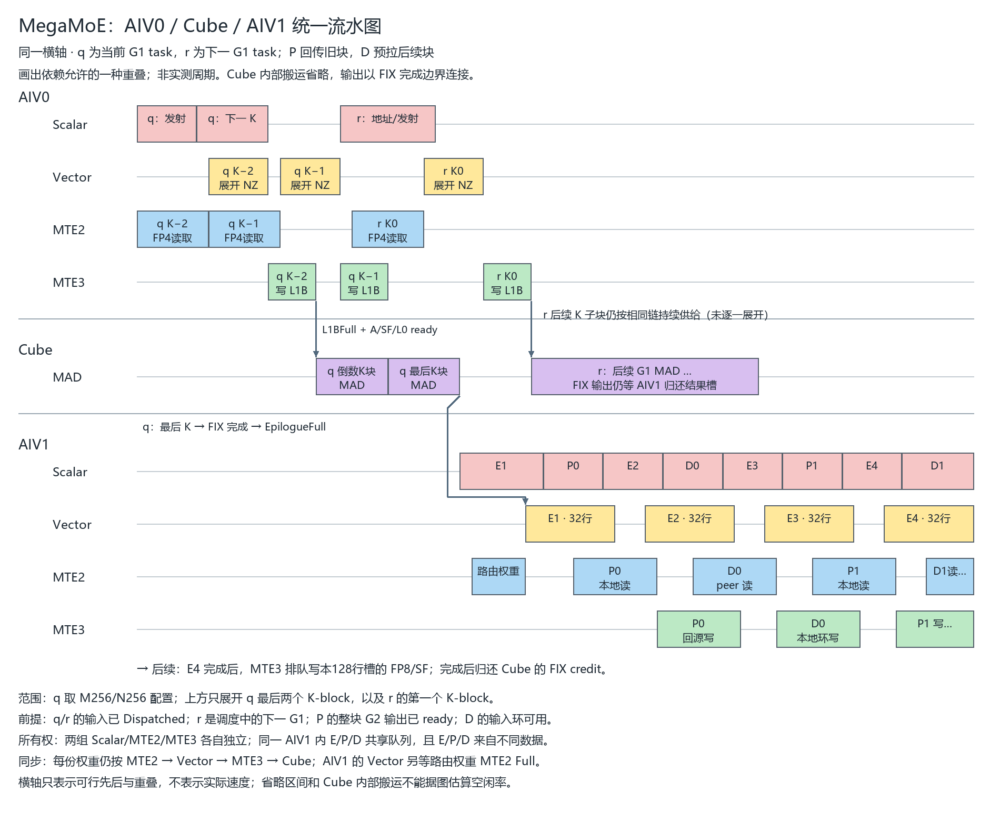
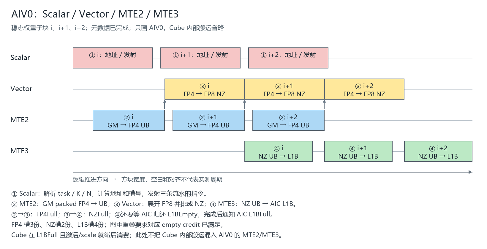
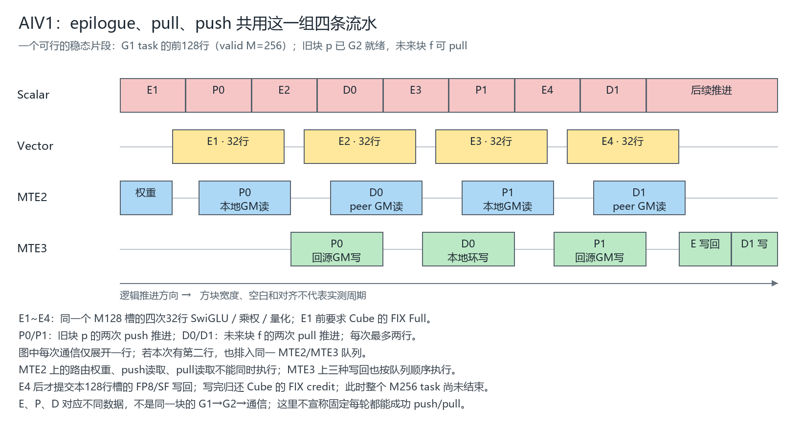

# MegaMoE：AIV0 / Cube / AIV1 统一执行流水

合图以同一横轴排列 AIV0 四条流水、Cube MAD 轴、AIV1 四条流水。展示一个稳态窗口：当前 G1 task q 的最后两个 K-block、下一 G1 task r 的权重预取/计算，以及 AIV1 对 q 的128行结果槽做量化，同时回传旧块 P、拉取后续块 D。

q 取 M256/N256 配置，每个画出的权重块对应整个 K-block；AIV0 后续仍持续供给 r 的其余 K-block，只是不逐一展开。Cube 内部的 MTE2/MTE1 搬运省略，但对应输入、scale、L0和槽空间依赖仍必须满足。箭头连接的是完成条件，不代表零延迟。

合图中最后的 E4 写回位于可见窗口之后：E4 完成才向 MTE3 提交该128行槽的 FP8/SF 写回，完成后才归还 FIX credit。r 的 MAD 可以先行，r 的 FIX 输出仍受结果槽 credit 约束。P 的 G2 发生在更早的计算阶段，已完成是本窗口的前提；本图不把 q 的 G1 和 P 的回传误认成同一块。

图中所有条形均为依赖允许的一种排布，无实测时间刻度。以下两张分组图保留为局部细节。

按用户确认的标准：**AIV0、AIV1 各自画 Scalar、Vector、MTE2、MTE3**。Cube 只说明接口依赖，内部搬运暂不展开。上一版混合角色、业务阶段、硬件资源的四张图不再作为本分析依据。

源码基线为 ba57d7e 加当前工作区。以下是满足前置条件的一种可行重叠，不是 profiler trace；宽度、空白和对齐不表示实测周期，也不保证每轮都达到图示重叠程度。

## 1. 划分标准

| 所属 AIV | Scalar | Vector | MTE2 | MTE3 |
| --- | --- | --- | --- | --- |
| AIV0 | 元数据调用/证书、权重task/地址、发射控制 | 元数据SIMT VF、FP4展开和NZ排布 | routed FP4 GM→UB | routed FP8 NZ UB→AIC L1B |
| AIV1 | E/P/D小步调度、路由寻址、身份GM写、完成发布 | G1 SwiGLU/乘权/FP8量化 | 路由权重读、Dispatch peer输入读、Combine本地输出读 | 激活GM写、Dispatch本地环写、Combine回源写 |

每组硬件为1 AIC配2 AIV。两组各自拥有对应执行队列；AIV0的MTE2与AIV1的MTE2不能合成一条队列，但可能竞争下层带宽。Cube一侧的激活/scale搬运属于AIC，不能并入上述任一AIV的MTE2。

## 2. AIV0：连续权重子块的四流水

源码：[权重流水](../deep_gemm/include/deep_gemm/mega_moe.hpp#L506)，[内层循环](../deep_gemm/include/deep_gemm/mega_moe.hpp#L620)。

1. Scalar解析G1/G2 task、expert、N/K子块，计算GM/UB/L1地址和槽号，发射指令。
2. MTE2：packed FP4 GM→FP4 UB；等待该目的槽FP4Empty，完成发布FP4Full。
3. Vector：等待FP4Full和NZEmpty，展开FP8并排成NZ；完成释放FP4槽、发布NZFull。
4. MTE3：等待NZFull和AIC归还的L1BEmpty，NZ UB→AIC L1B；完成释放NZ槽、发布L1BFull。

同一子块必须②→③→④；不同子块可形成“装下一份、展开当前份、发送上一份”的重叠。

| 空间 | 槽数 | 回收时机 |
| --- | --- | --- |
| packed FP4 UB | 3 | Vector读完 |
| FP8 NZ UB | 2 | MTE3读完 |
| AIC L1B | 4 | AIC MTE1最后读取完成 |

Scalar条表示控制/发射片段，不代表数据执行时长。PIPE事件的等待发生在指定目标流水，不能一律当作Scalar等待。Cube所需子块L1BFull且激活/scale等条件满足即可执行，不必等全部权重准备完。

本图开始前，AIV0已完成元数据：入口屏障→SIMT计数→grid sync→前缀/压紧→grid sync→远端元数据写→grid sync/fence→count/arrival→32核块数证书。VF完成通过V→S事件确认，然后复用UB做权重。SIMT内部GM访问不能直接画成显式MTE2/MTE3搬运。

## 3. AIV1：E、P、D共用同一组四流水

源码：[epilogue](../deep_gemm/include/deep_gemm/mega_moe.hpp#L1551)、[pull](../deep_gemm/include/deep_gemm/mega_moe.hpp#L1331)、[push](../deep_gemm/include/deep_gemm/mega_moe.hpp#L1750)、[主循环](../deep_gemm/include/deep_gemm/mega_moe.hpp#L1898)。

为避免把同块依赖误画成并行，图中前提明确如下：

- E属于当前G1 task的前M128槽，task实际M=256；该槽FIX Full可消费。
- P属于更早的块p，完整G2输出已就绪。
- D属于后续块f，元数据及输入环空间已就绪。
- 这是稳态片段，开始时软件偏好push；不是从入口启动开始的固定调度。
- 每次通信只展开其中一行；实际一次推进最多两行，都依次排入相同MTE2/MTE3队列。

**E：epilogue。** Scalar探测issued并推进游标；MTE2在槽首读FP32路由权重；Vector等FIX Full和权重Full后，做BF16→FP32、clamp、SwiGLU、乘权、amax/scale和FP8转换。E1~E4各最多32行，合计处理一个128行槽。整个槽处理完才向MTE3提交FP8及scale写回；MTE3写完才归还Cube的FIX credit。

这里特意选M256 task的前128行，E4后task尚未结束，不会立即进入完整task末尾的Scalar stores确认，因此可以继续交错通信。完整task结束时还需确认写完，才贡献一次Linear1Ready。

**D：Dispatch。** Scalar解析来源/地址→MTE2读peer FP8 token和scale→MTE3写本地输入环。Scalar还写路由权重、返回身份及可选route_m_blocks，可与已提交DMA重叠。块末等MTE3→S后发布Dispatched。token已是FP8，D没有Vector量化。

**P：Combine。** Scalar读返回身份/地址→MTE2读本地BF16输出→MTE3写源rank独立top-k接收槽。P也没有Vector算术。

pull有2个UB槽，push有4个UB槽。缓冲不同，但它们共用同一AIV1的MTE2/MTE3队列。

图中MTE2顺序为：路由权重→P0读→D0读→P1读→D1读。MTE3顺序为：P0回源写→D0本地写→P1回源写→E激活写→D1本地写。E写在E4时提交，D1写排在其后，不能为了增加视觉重叠颠倒提交顺序。

Vector可与其他块的DMA重叠；同一MTE2队列上的两个搬运不能画成两套并行引擎。软件先推进epilogue，再尝试push/pull；不ready会返回或回退，不是每轮必定成功一组E+P+D。

## 4. Cube只保留接口依赖

| 依赖 | 放行条件 |
| --- | --- |
| AIV0权重→Cube子乘 | 相关L1BFull，还需激活/scale及L0就绪 |
| AIV1 Dispatch→同块G1 | 32个AIV1完成输入/身份发布，Dispatched=32 |
| G1→对应槽量化 | 最后K完成后的FIX Full；issued只证明提交 |
| AIV1量化→同块G2 | 全部G1列task完成，Linear1Ready=I/128 |
| G2→同块push | 全部G2列FIX写完，Linear2Ready=H/256 |
| AIV1→Cube复用输出UB | 该槽激活MTE3写回完成后的EpilogueEmpty |

同一块必须遵守Dispatch→G1→量化→G2→push。图中的E/P/D来自不同块，所以能重叠；不能取消同块依赖。G1结果按task/槽逐步产生，也不能用一个全块G1时间条强行表达各槽的精确时间。

G1/G2任务顺序由依赖前缀加lookahead决定，不固定一比一交替。没有trace，本次不凭经验补画精确Cube时间条。

## 5. 对性能分析的含义

- AIV0供权不足：分别看MTE2、Vector、MTE3，还是L1BEmpty反压；后者可能源于Cube或激活消费慢，加槽未必有效。
- AIV1争用：量化用Vector，但权重读、激活写仍占MTE2/MTE3，与pull/push竞争。按队列衡量，不能把三种业务当三套硬件资源。
- 槽回收：FIX credit等激活写完；CombineSent等回源写完，分别反压Cube结果槽和GM输出环复用。
- 软件粒度：32行epilogue、最多2行通信、常规4块push批量确认，会影响发射和空间释放；收益需实测。

GM环另有三条覆盖约束：输入环等旧块Linear1Ready；中间激活环等旧块Linear2Ready；输出环等旧块CombineSent。UB empty不能替代这些完成证书。

尾部reduce也使用上述各AIV已有资源：Scalar判断可读→MTE2多路BF16读→Vector用FP32求和/转BF16→MTE3最终写。它不新增执行流水。本次不另画独立Reduce引擎。

## 6. 验证范围

复现：`python docs/scripts/render_megamoe_execution.py`，生成统一图和两张分组细节PNG。绘图依赖 Pillow 和 Windows 微软雅黑字体。已核对源码调用、事件、队列顺序及文字布局；未编译NPU内核、未采集设备trace，图中没有实测耗时。

当前用户工作区combine_reduce的修改删除了原else，使原非overlap尾部rank barrier进入overlap分支。非overlap有读取未就绪接收槽的竞争风险；本次保留内核原样，不将同步修复混入绘图修订。
