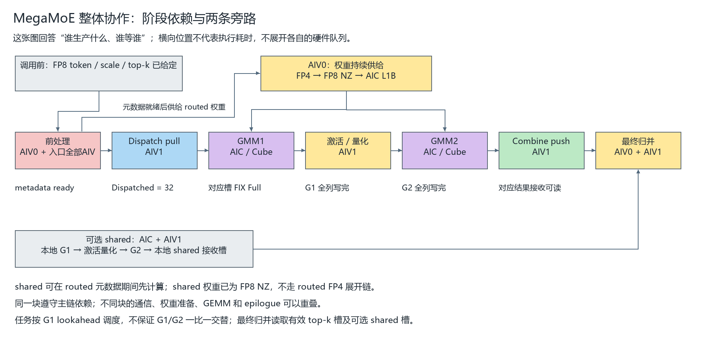
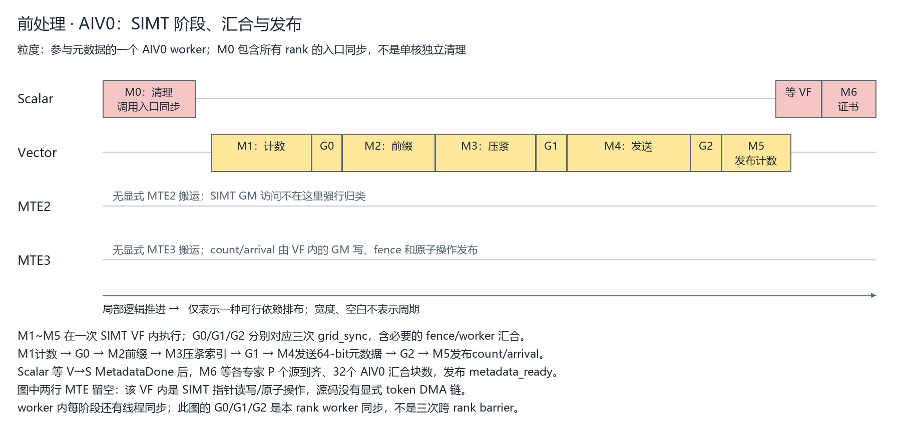
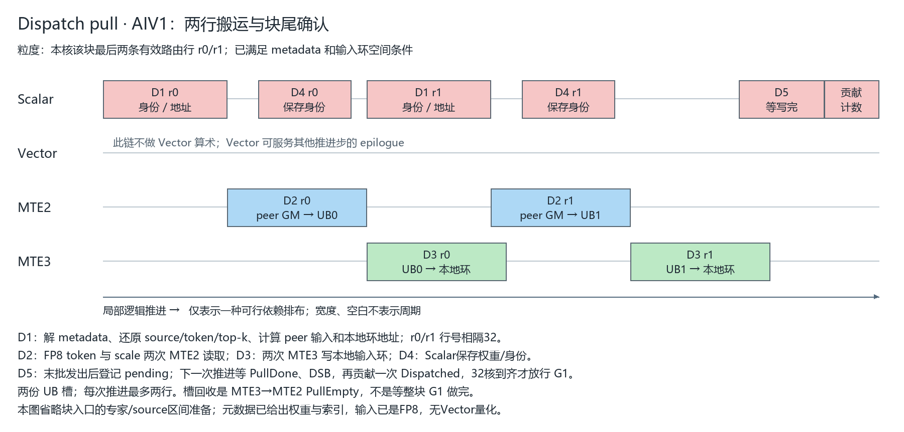
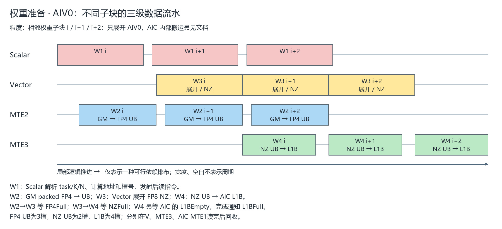
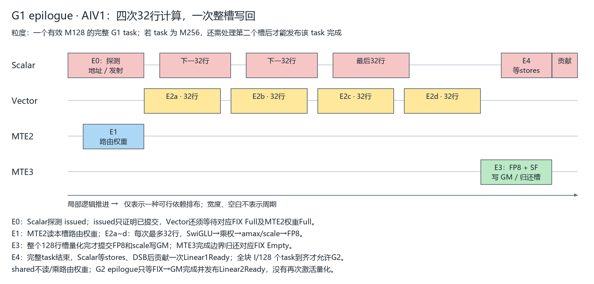
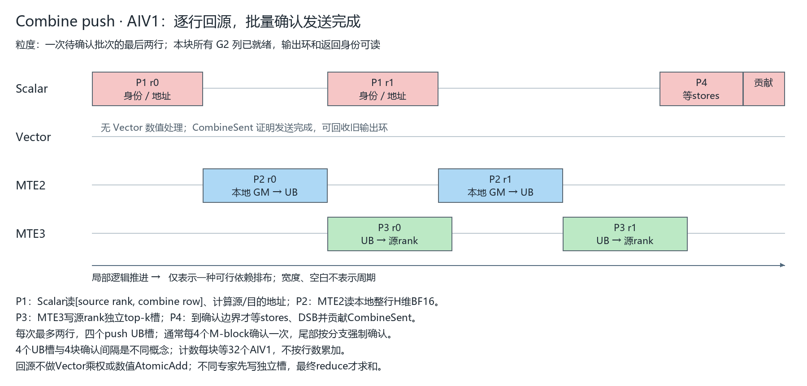
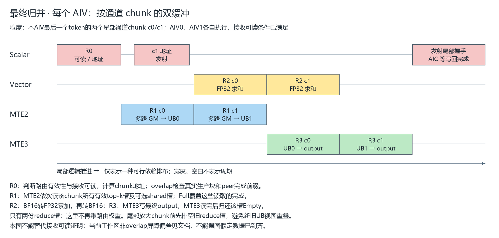
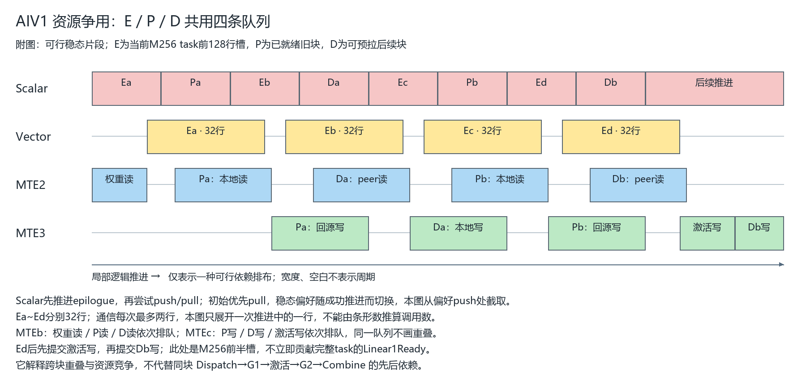

# MegaMoE 性能分析：步骤拆解、整体协作与局部执行流水

分析日期：2026-10-21。代码基线为 `ba57d7e`；`bd18dda`只增加了上一版图文。另检查了当前工作区的内核差异，差异与尾部同步有关，单列在第8节，不将它混进已验证设计假设。

本文按三个层次组织：**先说明每一步做什么，再画整体阶段协作，最后按AIV执行资源展开局部流水**。整体图不是硬件时间轴；局部图每张都有自己的处理粒度，横向长度不能跨图比较。所有条形、间距和重叠均为静态依赖分析，无设备trace或耗时估计。

## 1. 第一步：完整步骤拆解

### 1.1 入口约定和数据含义

输入FP8 token、scale、top-k expert索引及FP32 top-k权重由调用方给定。内核不计算top-k，也不把原始BF16输入量化为FP8。routed专家权重为packed FP4；shared权重已为FP8 NZ。

一个核组为1 AIC配2 AIV，总计32 AIC和64 AIV。AIV0主要负责路由元数据与routed权重准备；AIV1负责GEMM结果处理和通信；两侧AIV最终都参加输出归并。

记H为hidden、I为单专家intermediate、P为rank数、R为GM环槽数。源码中的`l1_acts/l2_acts`是第一/第二层GEMM输入的名字，**不是硬件L1/L2 cache**。逻辑M-block容量为256行，实际有效行数可以更少；一个M/N task只是该块的一部分输出列。

### 1.2 从启动到退出的步骤表

| 步骤 | 做什么 | 执行主体 | 输入 → 输出 / 存储 | 粒度 | 必须满足的前置条件 |
| --- | --- | --- | --- | --- | --- |
| H0 | 清本轮progress并launch | Host，同一stream | progress GM归零 | 一次launch | 输入与对称buffer已准备 |
| M0 | 清本地接收证书，入口跨rank同步 | 全部AIV | 本地count/块数证书 | 一次launch | 新轮远端发布尚未开始 |
| M1 | 扫描有效top-k，统计各专家路由数 | AIV0 SIMT VF | top-k GM → UB直方图 → worker计数GM | 一个worker覆盖的路由集合 | M0完成 |
| M2 | 求worker在每专家内的exclusive prefix | AIV0 SIMT VF | worker计数GM → UB写游标 | worker×expert | grid_sync<0>确认计数可读 |
| M3 | 再扫描top-k，按专家压紧路由索引 | AIV0 SIMT VF | top-k GM → staged索引GM | 一条有效路由 | M2；原子分配不重叠槽 |
| M4 | 将索引和权重打成64-bit项写远端 | AIV0 SIMT VF | staged/weight GM → owner metadata GM | 一条路由8B | grid_sync<1>确认staged表完整 |
| M5 | 发布每专家count及源到达贡献 | AIV0 SIMT VF，worker0 | count/arrival远端GM | expert×source rank | grid_sync<2>/fence覆盖元数据写 |
| M6 | 等源到齐，汇总本rank块数并通知消费者 | 32个AIV0 Scalar | arrival、块数证书 → metadata_ready/CV事件 | 专家与rank级汇合 | VF完成；专家P个源、32个AIV0均到达 |
| D | 按接收路由拉取token/scale，写本地输入环 | AIV1 Scalar/MTE2/MTE3 | peer FP8/SF GM → UB → 本地GM | 单行；每步最多两行 | metadata ready；输入环旧块已消费 |
| W | 读取FP4、展开FP8 NZ、送入AIC L1B | AIV0 Scalar/MTE2/V/MTE3 | 权重GM → FP4 UB → NZ UB → L1B | 一个权重子块 | 当前task已知；三层目的槽可用 |
| C1 | 第一层GEMM与FIX输出 | AIC | FP8输入/权重/SF → FP32 L0C → BF16 UB | M/N task，跨K累加 | 同块Dispatched、权重/scale/L0就绪、结果槽empty |
| E | SwiGLU、乘路由权重、FP8量化并写GM | AIV1 | BF16投影UB + route weight → FP8/SF中间GM | 每步≤32行；槽≤128行 | 对应FIX Full、权重Full、中间环可写 |
| C2 | 第二层GEMM与FIX输出 | AIC | FP8中间激活/权重/SF → BF16输出GM | M/N task，跨K累加 | 同块全部G1列量化写完；输出环可覆盖 |
| P | 将整行BF16输出回传原source | AIV1 Scalar/MTE2/MTE3 | 本地GM → UB → source top-k槽GM | 单行；每步最多两行 | 同块全部G2列写完 |
| R | 多路BF16结果求和，写最终BF16 output | AIV0/AIV1 | top-k/shared接收槽GM → UB → output GM | 原token的通道chunk | 每条有效路由结果可读；shared可读 |
| T | 最终写回完成握手，AIC退出 | 两侧AIV → AIC | PIPE_MTE3 block arrive/wait | 每个核组 | 覆盖所有最终output stores |

这张表描述依赖，不表示一次launch严格按行逐阶段清空后才进入下一阶段。不同块、不同task可重叠，shared又是一条独立的本地计算路径。

## 2. 第二步：整体阶段协作图



这张图只回答“谁产生数据、谁消费数据”。主链是：前处理→Dispatch→GMM1→激活量化→GMM2→Combine→最终归并。AIV0权重流为两个GEMM供给另一条输入；可选shared计算无需routed重排，可在元数据期间先做，最终贡献一个shared接收槽。

图中节点不等于一次固定长度的task：G1结果按task/槽逐步产生，AIV1能处理已经完成的槽，不必等全rank所有G1结束。G2仍必须等自己M-block的全部G1列完成。Combine读取完整H维行，因此等本块全部G2列，而不是某个N256 task结束就发送整行。

### 2.1 粒度与完成证书不能混用

| 对象 | 粒度 / 含义 |
| --- | --- |
| DMA一次操作 | Dispatch输入一行H维FP8或其scale；Combine一行H维BF16；不是一个256行M-block |
| AIV1一次推进 | epilogue最多32行，或pull/push最多两行；不是整个任务完成 |
| epilogue UB槽 | 最多128行BF16投影；四次32行可填完一个满槽 |
| G1 task | 一个M-block的N256 gate/up投影，激活后贡献128列 |
| G2 task | 一个M-block的N256输出 |
| wave | 最多32个M/N task；不是固定token数，也不必恰好覆盖32个M-block |
| Dispatched | 每块32个AIV1各贡献1次，证明输入及身份可读 |
| Linear1Ready | 每块I/128个G1 task各贡献1次，证明全中间宽度已量化写回 |
| Linear2Ready | 每块H/256个G2 task各贡献1次，证明全H维BF16输出已写回 |
| CombineSent | 每块32个AIV1各贡献1次，证明旧输出已发送，可复用输出环 |

shared计数存在专用分支，不能机械套用上表的routed目标值。调度器使用G1依赖前缀加lookahead，而非固定一波G1、一波G2；同一wave末尾没有额外全核barrier。

## 3. 第三步：前处理AIV0的细粒度拆解



入口M0由全部64个AIV分摊清本地count、由指定AIV清总块数证书，再调用rank_barrier<0>。这个屏障防止新轮远端计数被慢rank的清零覆盖。

元数据worker数量为`min(max(ceil(T*topk/512),1),32)`，一个worker对应一个AIV0上的512线程SIMT VF。即使T=0也保留worker，向各专家贡献零行到达，避免消费者永久等待。

| 步骤 | 实际动作 | 同步及性能含义 |
| --- | --- | --- |
| M1 | UB直方图统计有效expert；写worker_expert_count | 每条路由在worker内争用expert计数；grid_sync<0>后其他worker才能计算前缀 |
| M2 | 累加更早worker计数，得到exclusive prefix，UB计数转为写游标 | 生成每worker不重叠的专家槽区间 |
| M3 | 原子领取专家槽，写staged_token_topk_idx | grid_sync<1>之前，发送warp不能假设任意worker段均已完成 |
| M4 | warp分担专家，读取源token-top-k索引与weight bits，写peer uint64元数据 | 高32位是权重bits，低32位是token*topk+slot；不发送H维激活 |
| M5 | worker0写source-major count，fence后原子累加arrival bit和count | grid_sync<2>确保先元数据、后可读证书；零count也贡献到达位 |
| M6 | V→S MetadataDone；各AIV0等分管专家的P源到齐，再原子汇合块数 | 32个AIV0都贡献，包括没有分管工作的核；完成后发布GM metadata_ready和给AIC的CV事件 |

**这不是原示例的Duplicate/sub/Abs/Min/ReduceSum计数链。** SIMT VF内部通过指针访问GM及执行原子操作，源码没有显式metadata MTE2→UB→MTE3链。图中的Vector行表示VF所在V执行路径，MTE2/MTE3保持留空；精确SIMT指令归属需编译产物或设备trace确认。

三个grid_sync是本rank参与worker的同步，不是三次跨rank barrier。发送后也没有再次rank_barrier：源到达证书负责接收端完整性。前处理是阶段化发布，不是看到一个top-k就立刻启动对应token pull。

**观察重点：** worker数量是否过少、热点expert原子争用、三次grid同步尾差、远端元数据写、最慢source到达和32核证书尾差。拆分元数据发布粒度属于协议修改，需同步重设计消费者，不能只删除fence或同步。

## 4. Dispatch AIV1的细粒度拆解



块入口D0先检查输入环空间，推进专家游标，读取各source count建立区间，并用互质stride置换源ordinal，分散连续peer访问。图只展开该核块尾两条有效行，D0不放入逐行重复链。

| 步骤 | 流水 | 做什么 / 输入输出 | 依赖与释放 |
| --- | --- | --- | --- |
| D1 | Scalar | 读取本地uint64路由项，解source/token/top-k，计算peer FP8/SF和本地环地址 | 元数据可读；代码在读当前条目前还消费该槽PullEmpty |
| D2 | MTE2 | 分别把peer token、scale搬到同一stage的两块UB区域 | 目的UB不再被旧MTE3读取；最后Full覆盖两次读取 |
| D3 | MTE3 | token和scale分别写本地l1_acts环 | 等MTE2→MTE3 PullFull；完成释放PullEmpty |
| D4 | Scalar GM stores | 保存权重bits、source rank/返回行；overlap时记录真实route_m_blocks | 使用D1已知身份，可与已发射DMA重叠；不是Vector FillTriple |
| D5 | Scalar | 末批标pending，下次推进等PullDone、DSB后贡献Dispatched | 本核所有有效行stores及身份发布完成；无有效行owner也贡献 |

32个AIV1分摊一个逻辑块，第c核处理`c+32*k`行；两份pull UB按本核行序号对2取模。一次advance最多两行，满M256块每核最多8行，不能把“两槽”解释成整个块只搬两行。

同一槽循环：`MTE2读→PullFull→MTE3写→PullEmpty→后续MTE2读`。此路径没有token量化，也没有在token尾部插三元组或flag的Vector拷贝。身份与进度分别保存在GM区域。

按(token,top-k slot)逐路由搬运，没有按(token,destination rank)去重。同一token命中同一rank多个专家可能重复读输入。H=4096时，每路FP8数据4096B、SF为128B；经历peer→UB和UB→本地GM两段，G1还需从本地GM读取。

**观察重点：** peer读带宽、重复路由率、Scalar索引开销、块尾32核完成尾差、输入环空间限制，以及AIV1被epilogue/push占用。增加单次行数可减少控制开销，也可能推迟FIX槽回收或push，需整体测量。

## 5. 权重与Cube接口：独立保留，但不强拼时间轴



| 步骤 | 流水 | 操作 | 读写空间及生命周期 |
| --- | --- | --- | --- |
| W1 | Scalar | 解析task、expert、K/N子块、地址和stage | 三种stage独立轮转 |
| W2 | MTE2 | packed FP4 GM→UB | FP4 UB为3槽；等待FP4Empty，完成发布FP4Full |
| W3 | Vector | 位操作展开FP8并排成padded NZ | 等FP4Full和NZEmpty；完成释放FP4槽、发布NZFull |
| W4 | MTE3 | NZ UB→AIC L1B | 等NZFull和AIC的L1BEmpty；完成释放NZ槽、发布L1BFull |

NZ UB为2槽，L1B为4槽。FP4在V读完即可回收，NZ在MTE3读完回收，L1B在AIC MTE1最后读取完成回收。不能统一称为双缓冲，也不能等整个Cube算完才归还L1B。

Cube内部搬运不另画时间条，但必须明确真实路径：AIC的MTE2将激活/scale装L1，MTE1将A/B/SF装L0，Cube做MAD跨K累加，最后K完成后FIX输出。G1经FIX写AIV1 BF16 UB；G2经FIX直接写BF16 GM。AIC拥有的MTE2/MTE1不能并入AIV0或AIV1的DMA轴。

routed valid M≤128时使用K512及N128子乘，一个逻辑N256分两次；M>128时使用K256、N256。图的相邻子块定义按实际配置推进，不表示某个固定配置的完整K-loop时长。shared权重已为FP8 NZ，由AIC装载，不经过此FP4展开链。

**观察重点：** Cube等待L1BFull说明供给或上游受阻；AIV0等待L1BEmpty则说明消费端/激活可能更慢。routed权重仍按task读取和展开，没有整个专家权重跨M-block永久驻留L1的保证。

## 6. G1 epilogue AIV1：局部后处理



这里的后处理是“G1结果的局部后处理”，要与最终Combine归并区分。

| 步骤 | 流水 | 操作 | 关键条件 |
| --- | --- | --- | --- |
| E0 | Scalar | 重放task序列；探测num_issued_gemms，计算槽/行偏移 | issued只表示AIC已提交，不能代替FIX Full |
| E1 | MTE2 | 槽首读取该槽有效行的FP32路由权重 | 等旧权重不再被V读取；后续32行小步复用该份权重 |
| E2 | Vector | BF16转FP32、clamp、SwiGLU、乘路由权重、amax/scale、转换FP8和写SF | 首组等待该槽全部gate/up列FIX Full及权重Full |
| E3 | MTE3 | 整个槽量化完后写FP8/SF到中间GM | V→MTE3 QuantFull；完成边界归还EpilogueEmpty |
| E4 | Scalar | 完整task结束，等stores、DSB，贡献Linear1Ready | 最多两个M128槽都完成，才能贡献该task的一次完成 |

每个G1 task投影N256（gate128/up128），激活后输出128列。一个槽最多128行，每次最多32行；不能把完成32行、完成槽、完成task和全M-block ready当成一个事件。

量化将加权激活原地压紧到原BF16 UB前部，每行512B投影变为128B FP8输出。路由权重在非线性激活之后、amax及FP8量化之前乘入；最终reduce不再乘权。提前乘权与G2后乘权存在不同量化舍入过程，不能推断逐位等价。

shared没有路由权重读取和乘权，其余SwiGLU/量化逻辑类似。G2 epilogue不重复做这些算术：Scalar等FIX→GM Full、归还credit并贡献Linear2Ready。后者只证明生产结束，未证明旧输出已被Combine读走。

**观察重点：** FIX Full等待、Vector算术、整槽写回、task末Scalar stores等待分别花多久。更小分段写回可能更早释放空间，也会增加DMA/事件与credit复杂度，不能把32行计算步长直接改成32行完整ready。

## 7. Combine与最终后处理：拆成两张图

### 7.1 Combine push AIV1



| 步骤 | 流水 | 做什么 | 依赖 / 完成意义 |
| --- | --- | --- | --- |
| P0 | Scalar探测 | 新块入口检查Linear2Ready=H/256，取得valid M和输出环首行 | 未就绪返回主循环，不跳过该块偷发后续块 |
| P1 | Scalar | 从完整逻辑身份区读source rank和combine row，算地址 | 身份不随物理环取模 |
| P2 | MTE2 | 本地整行H维BF16 GM→push UB | 等PushEmpty；完成发PushFull |
| P3 | MTE3 | UB→原source rank对应top-k槽 | 等PushFull；完成释放PushEmpty |
| P4 | Scalar | 到批量确认边界等stores，DSB后为每块贡献CombineSent | 证明旧输出已读走且发送完成，可回收输出环 |

每次最多两行，UB为4槽。常规每4个M-block确认一次，非overlap末块强制确认；overlap最后一个非空专家改为逐块确认。四槽是缓冲容量，四块是确认间隔，二者不能等同。

回传完整H维行，H=4096时为8192B BF16；不做数值AtomicAdd，也不在专家生产rank先合并同token结果。各路由写独立top-k槽，留到source端归并。

**观察重点：** push读写带宽、Scalar身份寻址、批量确认等待、CombineSent推迟导致的输出环反压。测试1/2/4块确认时，要同时测控制开销和环占用，而非只看单次发送延迟。

### 7.2 最终reduce：AIV0和AIV1各自执行



| 步骤 | 流水 | 做什么 | 关键依赖 |
| --- | --- | --- | --- |
| R0 | Scalar | 判断有效路由、可读性、通道chunk及地址 | overlap需route_m_blocks给出真实生产块，且其编号小于peer完成前缀；shared有专用ready检查 |
| R1 | MTE2 | 依次读该chunk所有有效top-k BF16槽及可选shared槽，紧凑装入UB | ReduceFull覆盖本chunk的全部输入读取 |
| R2 | Vector | BF16转FP32，累加，再转换BF16，结果放该槽前部 | 等ReduceFull；不再乘top-k权重 |
| R3 | MTE3 | 写最终output[token,channels] | 等ReduceOutputFull；完成释放ReduceEmpty |
| R4 | 完成握手 | 两侧AIV分别在PIPE_MTE3完成边界通知AIC，AIC等待后退出 | launch完成覆盖最终输出写回 |

两个reduce槽按通道chunk轮转。尾部阶段停止权重/通信用途、排空已启动的reduce槽，再复用整UB创建更宽chunk；不能直接更换chunk宽度而保留旧槽在途。

overlap协议编译阈值按注册Tmax的接收工作量是否大于32MiB决定；还要满足尾部窗口和总块数大于GM环等条件才在主体里插入小chunk归并。AIV1还要求本核issued与completed相等，避免已有FIX结果无人消费。它不是从kernel开头持续并行归并。

非overlap设计通过尾部rank barrier确认全部接收可读；当前工作区该分支有偏差，见第8节。不能把图上R1的出现本身当作数据到达证明。

**观察重点：** 接收就绪等待、MTE2多路读取带宽、V求和、MTE3最终写回，以及放大尾部chunk前的排空开销。early reduce会争用主流水已有的V/MTE2/MTE3，收益应看整体长尾而非单独reduce耗时。

## 8. 最后看AIV1资源争用和跨阶段反压



这张图只是附图，专门解释共享资源。Ea~Ed是四个量化小步，Pa/Pb和Da/Db是两次通信推进的局部编号，不是前面步骤表的操作ID。E属于当前G1 task前128行槽；P属于已完成G2的旧块；D属于可以拉取的后续块。E/P/D不是同一个M-block，所以能重叠。它不能代替整体主链，也不承诺每轮都成功一组E+P+D。

主循环优先推进epilogue，然后尝试push/pull；尚未ready的阶段返回，偏好在成功的通信推进之间切换。两类通信UB独立，但权重读取、push读取、pull读取共用本AIV1的MTE2队列；激活写、push写、pull写共用本AIV1的MTE3队列。AIV0对应资源属于另一个AIV，不应画成与AIV1共用一条队列。

### 8.1 数据依赖、片上空间依赖和GM环空间依赖

| 层次 | 例子 | 不能拿什么替代 |
| --- | --- | --- |
| 数据已生产 | FIX Full、PullFull、QuantFull | 不能用“Scalar已提交指令”替代完成 |
| 片上空间可复用 | PullEmpty、NZEmpty、L1BEmpty、EpilogueEmpty | 不能只凭GM进度计数推断所有局部槽均空闲 |
| GM输入环可覆盖 | 新块b写输入前等旧块b-R的Linear1Ready | 不能只等pull UB empty |
| GM中间激活环可覆盖 | 新块b激活写前等旧块b-R的Linear2Ready | 不能只归还FIX UB credit |
| GM输出环可覆盖 | 新块b的G2 FIX写前等旧块b-R的CombineSent | 不能只等旧块Linear2Ready |

数据用物理b%R定位，进度和路由身份保留完整逻辑块号。进度计数的单位是贡献次数，不能拿token数、DMA数或wave数替代。

### 8.2 已发现但未修改的工作区偏差

本地`mega_moe.hpp`中，原`combine_reduce`的`} else {`被用户未提交修改删除，导致原非overlap尾部rank_barrier进入overlap分支。当前非overlap路径缺少原有跨rank接收完成边界，其reduce又没有overlap逐路由前缀检查，存在读未就绪结果的竞争风险；overlap尾部则多了全rank汇合。

本文将这个差异与HEAD设计分开说明，不将其当作性能优化。内核修改保留原样，图文提交不包含该改动。在非overlap正确性恢复/证明之前，不应据其测得收益判断流水优化有效。

## 9. 源码索引、复现与验证范围

| 源码 | 本文核对的函数 / 定义 |
| --- | --- |
| [主内核](../deep_gemm/include/deep_gemm/mega_moe.hpp) | mega_moe_impl；aiv0_weight_pipeline；aic_gemm_pipeline；aiv1_epilogue_comm内的三个advance；advance_combine_reduce；combine_reduce |
| [通信](../deep_gemm/include/deep_gemm/comm/mega_moe.hpp) | build_dispatch_metadata；grid_sync；wait_dispatch_metadata；rank_barrier；进度探测 |
| [向量计算](../deep_gemm/include/deep_gemm/simd/mega_moe.hpp) | vf_fp4_to_fp8_nz；vf_swiglu_quant；vf_combine_reduce |
| [调度](../deep_gemm/include/deep_gemm/scheduler/mega_moe.hpp) | take_linear_task；ExpertCursor |
| [布局](../deep_gemm/include/deep_gemm/layout/mega_moe.hpp) | 环形激活/输出、元数据和progress布局 |
| [同步封装](../deep_gemm/include/deep_gemm/ascend/sync.hpp) | 有向PIPE事件；AIC/AIV intra-block事件 |
| [启动](../csrc/jit_kernels/mega_moe.hpp) | 同stream清progress后launch |
| [硬件配置](../deep_gemm/include/deep_gemm/common.hpp) | 32 AIC / 64 AIV；UB/L1/L0容量 |

复现全部8张图：

```powershell
python docs/scripts/render_megamoe_execution.py
```

需要Pillow和支持中文的TrueType字体。默认使用Windows微软雅黑；其他环境可用`--font /path/to/font.ttf`或`MEGAMOE_FONT`指定字体，`--out`指定输出目录。绘图脚本检查方块文字是否越界，生成静态PNG，不依赖网络。

本次验证覆盖源码调用/事件/队列/计数核对、全部图片渲染和可读性检查、文档链接检查。未运行Ascend编译、NPU正确性测试、多rank通信测试或profiling。因此结论为实现依赖与候选瓶颈分析，没有耗时数值、最优粒度或加速倍率承诺。

上一版统一九轴图与两张分组草图已由本版“步骤表＋整体依赖图＋局部资源图”替换，不再作为入口。
