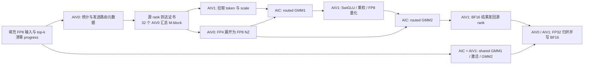

# MegaMoE 流水、调度、同步与存储设计

本文依据当前 `docs/megamoe-core-comments` 分支的实现分析，基线提交为 `8491bbb`。源码中的 `Linear1/Linear2` 分别称为 GMM1/GMM2；`l1_acts/l2_acts` 是两层 GEMM 的输入，名称中的 l1/l2 不代表硬件 L1/L2 cache。下文的空间和任务示例是按源码公式计算的结果，性能取舍属于设计分析，未在设备上重新测量。

核心设计是：32 个 AIC 各与两个 AIV 配合，AIV0 处理路由元数据和 FP4 权重展开，AIC 执行 shared/routed GEMM，AIV1 在 epilogue、Dispatch pull、Combine push 之间小步切换。任务按 M/N tile 调度，数据按逻辑 M-block 存放到 GM 环；本地 PIPE 事件、C/V 事件、GM 完成计数分别保护不同层次的依赖。

各阶段的单行DMA、两行推进、M-block、GEMM task和wave大小见 [任务粒度对照](megamoe_task_granularity_zh.md)。

## 1. 阅读入口与符号

| 文件 / 函数 | 负责的设计 |
| --- | --- |
| [Python API](../deep_gemm/mega/__init__.py)：`SymmBuffer`、`transform_weights_for_mega_moe` | 对称空间注册、权重预排布、调用约定 |
| [C++ API](../csrc/apis/mega_moe.hpp)：`get_workspace`、`fp8_fp4_mega_moe` | 注册维度与实际 token 数、shape/量化格式检查 |
| [JIT launch](../csrc/jit_kernels/mega_moe.hpp)：`launch_mega_moe` | 模板特化、同 stream 清 progress、32 block launch |
| [布局](../deep_gemm/include/deep_gemm/layout/mega_moe.hpp)：`Workspace` | GM 容量、对齐、逻辑块与环地址 |
| [调度](../deep_gemm/include/deep_gemm/scheduler/mega_moe.hpp)：`take_linear_task`、`ExpertCursor` | wave 大小、GMM1 lookahead、专家分块 |
| [通信](../deep_gemm/include/deep_gemm/comm/mega_moe.hpp) | 元数据前处理、到达证书、本地和跨 rank 屏障 |
| [主 kernel](../deep_gemm/include/deep_gemm/mega_moe.hpp) | 三角色流水、空间信用、收尾归并 |
| [SIMD](../deep_gemm/include/deep_gemm/simd/mega_moe.hpp) | FP4 展开、SwiGLU/量化、FP32 求和 |
| [同步封装](../deep_gemm/include/deep_gemm/ascend/sync.hpp) | PIPE 方向、subblock 与物理 flag 编码 |

记 `P` 为 rank 数，`E` 为全局 routed 专家数，`S` 为 shared 专家数，`T` 为本 rank 本次输入行数，`Tmax` 为注册容量，`Ktop` 为 top-k，`H` 为 hidden，`I` 为单专家 intermediate hidden，`C=32` 为 AIC 数。每个 rank 有 `E/P` 个 routed 专家。shared 专家以宽度 `S*I` 合并计算，并在 Combine 中占一个 shared 槽。

当前代码固定逻辑 `BLOCK_M=BLOCK_N=256`，硬件核数来自 `common.hpp`，运行入口也检查设备核数。一个 int16 scale pair 装两个 UE8M0 scale，每个 scale 对应 32 个 K 元素，故 `MX_SF_DIVISOR=64`。

## 2. 整体流水如何启动、运行和退出



启动阶段 AIC 可以先做 shared GMM1 和 GMM2，它们读取本地原始输入，无需 routed token 排列。与此同时，AIV0 执行 SIMT 元数据处理。AIV1 先参加入口屏障，再服务 shared epilogue；满足代码中的元数据轮询条件后，也可推进 routed pull。

转入 routed 时，AIC 先消费元数据事件，然后将 shared 用过的 L1B 区交给 AIV0。AIV0 可以提前在自己 UB 准备 FP4/NZ，但写 L1B 要等待 AIC 发放空槽信用。这样两个权重生产者不会同时覆盖 L1B。

稳态中，AIC/AIV0/AIV1 分别维护私有调度游标，重放相同 routed task 顺序。它们不要求同时走到一个 wave 边界；落后的生产者会通过 ready 事件阻止消费者，落后的消费者会通过 empty 事件或 GM 环依赖限制生产者。

退出时先排空通信和已启动的 reduce 槽，再把两侧 AIV 的整块 UB 重用于更宽的尾部归并。所有最终输出存储完成后，两侧 AIV 通过 block 事件 4 通知 AIC；AIC 等待后退出，使 launch 完成覆盖归并与写回。

## 3. wave 究竟多大

DeepSeek-V4-Flash 的具体 shape 代入、32 核映射和 EP8/EP64 示例见 [Flash 分核静态分析](deepseek_v4_flash_core_partition_zh.md)。

### 3.1 一个 wave 是 32 个 M/N task

`take_linear_task` 每次令某一阶段的 `task_base += C`。core c 执行 `task_idx=task_base+c`，超过该阶段任务数的 core 跳过该波。对 N-block 数为 `N` 的层：

```text
pool_block_idx = task_idx / N
n_block_idx    = task_idx % N
N1 = I / 128             # gate128 + up128 组成一个 N256 投影
N2 = H / 256             # GMM2 每个 task 输出256通道
GMM1 总任务数 = B * N1
GMM2 总任务数 = B * N2
B = sum_local_expert ceil(expert_rows / 256)
```

32 task wave 覆盖的 M-block 数取决于 N 和起始位置，可能跨专家；没有固定 token 数。一个 M-block 对应一个专家，专家内实际有效行数可能少于 256。wave 尾部也没有额外的全核同步。

### 3.2 GMM1 领先多少

设下一波 GMM2 的起点为 `b2`，GMM2 总任务数为 `B*N2`。调度器先要求：

```text
required_G1_end = ceil(min(b2 + C, B*N2) / N2) * N1
当 GMM1 尚未耗尽，且 G1_base < required_G1_end + C 时，继续发 GMM1 wave。
否则发下一波 GMM2；GMM2 耗尽后再处理可能剩余的 GMM1。
```

前一项覆盖下一波 GMM2 涉及的所有 M-block 的完整激活列，额外的 C 个 GMM1 task 留出激活处理的领先量。由于 base 按 32 递增，实际领先量会受取整影响。任务排在前面仅代表提交次序，GMM2 仍须等相应 `Linear1Ready`。

例如 `H=4096,I=3072`，得到 `N1=24,N2=16`，且假定 B 足够大：

| 顺序 | 阶段及 task 区间（左闭右开） | 原因 |
| --- | --- | --- |
| 1–3 | G1 `[0,32)`、`[32,64)`、`[64,96)` | 第一波 G2 涉及2块，需要48个 G1 task；加32后要求 base 至少80，实际推进到96 |
| 4 | G2 `[0,32)` | 两个 M-block 的 G1 任务已排到前面 |
| 5 | G1 `[96,128)` | 第二波 G2 所需前缀96，再加32 |
| 6 | G2 `[32,64)` | 满足前缀与 lookahead |
| 7–8 | G1 `[128,160)`、`[160,192)` | 第三波 G2 所需前缀144，再加32，推进至192 |
| 9 | G2 `[64,96)` | 继续消费先前激活 |

不能把这段逻辑理解为固定“一波 GMM1、一波 GMM2”，也没有把单个 wave 的所有 Dispatch、GMM1、GMM2、Combine 做完才进入下一波。

shared 的调度不同：每个 core 先遍历 shared GMM1，再遍历 shared GMM2，之后进入 routed 顺序。shared GMM2 仍按 M-block 等 shared GMM1 的全部激活列就绪。AIV0 以 shared token 数 0 重放调度，仅准备 routed 权重。

### 3.3 M-block、MAD shape 和数据环窗口

`ExpertCursor` 将专家行数先分成 16 行组，再均匀分配到 `ceil(rows/256)` 个逻辑块。257 行分成 144 和 113 行，而不是 256 和 1 行；两块的 GM stride 仍是 256。这个选择减少极小尾块，同时允许实际 MAD 形状随 valid M 变化。

| 条件 | K-loop 块 | MAD M/N/K | 单个逻辑 N256 的处理 |
| --- | --- | --- | --- |
| routed `valid_m<=128` | K512 | 128/128/256 | 两个 N128 子乘；L0A 复用 |
| routed `valid_m>128` | K256 | 256/256/128 | 一个 N256 子乘 |
| shared | 按整个本地 T 是否 <=128 固定形状 | 同上 | 避免 shared L1B 槽 stride 在尾块处变化 |

GM 环有 R 个 **M-block** 槽，不是 R 个 task：

```text
Bmax = ceil(P*Tmax*Ktop/256) + E/P
R = min(Bmax, 128)    当 H/256 <= C/2，即当前 H<=4096
R = min(Bmax, 32)     当 H>4096
ring_rows = 256*R
```

R 控制允许保留多少块数据，K-loop stage 数控制片上在途深度，wave 控制任务分配步长。这三种容量应分别调整和分析。代码将窗口标为经验选择；更小且不死锁的窗口，也可能因通信领先量不足而降低吞吐。

## 4. 前处理究竟处理了什么

### 4.1 调用前：输入和权重

调用方先提供量化后的 FP8 `x` 和 scale pair，填入对称 buffer 的有效 T 行，同时填入 `topk_idx` 和 FP32 `topk_weights`。融合入口从 y 的行数取得 T；注册容量 Tmax 始终用于 peer 布局步长。kernel 不计算 top-k，也不负责将原始 BF16 输入量化成 FP8。

`transform_weights_for_mega_moe` 可在加载模型时执行并复用结果。GMM1 权重从 `[全部gate,全部up]` 变成 `[N-block,gate128|up128,K]`，scale 同样交错，最终变成 `[N-block,K-pair,N]`。GMM2 按 N256 分块。

routed 权重仍为 packed FP4，每字节两值，进入 AIV0 后才按 tile 展开为 FP8 NZ。位操作展开得到 FP4 值除以 64，故预处理给 UE8M0 指数加 6；保留特殊指数 255，拒绝不能安全加 6 的有限指数。shared 权重本身为 FP8，提前转 NZ，由 AIC 直接加载，不需要这项补偿。

### 4.2 每次 launch：先隔离本轮状态

1. Host 在当前 stream 清零 `progress`，然后 launch；这个范围包含四阶段计数、每 core 的 issued 计数和 metadata_ready。
2. 64 个 AIV 分摊清零本地专家的接收计数总和，AIV 0 清零 M-block 证书。
3. AIV 通过入口 `rank_barrier<0>`，确认所有 rank 已清理后，才发布新的远端计数。否则快 rank 的增量可能被慢 rank 的清零覆盖。

首次分配/重新领取 HCCL buffer 时底层会清零；重复 launch 中 barrier epoch 保留。输入内容、路由表的容量区和中间数据不需要每轮全部清零，后续依赖有效长度、进度和到达证书识别有效内容。

### 4.3 AIV0：直方图、前缀、连续路由表

元数据 worker 数为 `min(max(ceil(T*Ktop/512),1),32)`，每个 worker 是一个 AIV0 上的 512 线程 SIMT VF。即使 T=0，也保留一个 worker，用来向各专家发布零行到达。

| 步骤 | 数据与同步 | 为什么这样做 |
| --- | --- | --- |
| 本地计数 | UB 的 `expert_token_count[E]` 对有效 expert ID 累加；写 `worker_expert_count[worker,E]` | 把跨线程争用先限制在本 worker UB |
| grid sync 0 | 所有 worker 直方图可见 | 每个 worker 求该专家在更早 worker 中的 exclusive prefix |
| 索引压紧 | UB counter 原地转写游标，写 `staged_token_topk_idx[expert,slot]` | 得到按专家连续、每 worker 段不重叠的源路由表 |
| grid sync 1 | staged 表全部可读 | 后续发送 warp 可读取任何 worker 产生的段 |
| 元数据发送 | warp 分担专家；每条远端 uint64 项为 `[weight_bits32,token_topk_idx32]` | 先把权重和源索引一起送到专家 owner，减少随后逐路由的远端 scalar 读 |
| grid sync 2 | threadfence + 全 worker 同步 | 所有远端元数据写完，再发到达计数 |
| 发布 count | 写 source-major `expert_recv_count`，fence 后原子加 `arrival_bit | count` | count 同时充当消费者可以读元数据的证书 |

无效 ID（包括转换成无符号后越界的 -1）不产生路由；同一 token 的两个 top-k 槽即使指向同一专家，仍是两条独立路由。零 count 也必须贡献到达位。

overlap reduce 关闭时，worker 轮转领取 512-route 批次；开启时，各 worker 领取连续的 512 倍数区间，批次间保序。批内原子分配槽位不能保证 token 严格排序，因此归并仍记录并检查真实生产块。

发送时机是阶段化的：本 rank 所有 metadata worker 先完成计数与 staged 索引表，再由 warp 按专家并行读取完整表、逐项向 peer GM 写出。不是扫描到一条 top-k 就立刻发送；发送阶段打包与远端写逐项执行，但所有本 rank 路由项经第三次 grid_sync/threadfence 后，才由 worker 0 发布各专家 count/arrival。不同 rank 可以处于不同阶段，没有在发送后再调用跨 rank 的 rank_barrier。

每条路由发送 8 字节，高32位为 FP32 top-k 权重原始位型，低32位为 `token*Ktop+slot`。目标 expert 与源 rank 隐含在接收地址 `[local_expert,source_rank,slot]` 中；H维 token、输入 scale、专家矩阵权重不在这条消息内。接收方 metadata 完整后，AIV1 再由索引定位 peer 输入并拉取 FP8 token/scale。

### 4.4 两级到达证书

`expert_recv_count_sum[e]` 的高 8 位是已到达源 rank 数，低 24 位是累计路由数。每个源都执行 `atomic_add((1<<24)|count)`，高位到 P 才算该专家元数据完整。Host 检查 `P*Tmax*Ktop < 2^24`，防止低位进位污染高位。

32 个 AIV0 分摊读取本地专家计数，各自累加 `ceil(count/256)`，再给 `num_m_blocks_certificate` 加上一个 AIV0 到达位及自己的块数。空闲 AIV0 也贡献到达位。高位达到 32 后，全体知道同一个 B，随后通过 GM metadata_ready 通知 AIV1，通过 CV flag 2 通知 AIC。

这里不需要 CPU 取回专家 counts 再重新 launch GEMM，代价是设备内的计数、同步和私有游标管理。

## 5. 三条角色流水的具体处理

### 5.1 AIV0 权重：三种槽位分别回收

```text
GM packed FP4 --MTE2--> UB FP4[3]
              --V-->   UB padded FP8 NZ[2]
              --MTE3--> AIC L1B[4]
              --MTE1--> AIC L0B[2] --M--> FP32 L0C
```

FP4 槽在 V 完成展开后可复用；NZ 槽在 MTE3 搬入 L1 后可复用；L1B 槽在 AIC 的最后一次 MTE1 读取后可覆盖。三个 cursor 独立按 3/2/4 取模，不能用同一个 ping-pong 位。M128 的一个 K512 块需要两个 N128 权重槽，M256 的 K256 块使用一个 N256 槽，两者每槽都是 64 KiB。

任务切换时继续推进这些槽位，ready/empty 限制实际领先距离。当前 routed 路径仍会按 task 读取、展开权重；L2 cache hint 根据专家是否多于一个 M-block 调整，不能由此推断已经实现“整个专家权重驻留 L1、跨 M-block 零重载”。

### 5.2 AIC：A、B、scale 与 FIX

A 使用三个 L1 槽，routed B 由 AIV0 的四个 L1 槽供给。shared B 则由 AIC MTE2 自己搬运。每个 scale 槽存 32 个 pair，即覆盖 K2048；对 K512 是四个 K-loop 块，对 K256 是八个块，直到最后一次消费才回收 scale credit。

在首次读取激活前，AIC 可以先发出独立的 shared 权重/B scale 读取，再等 `Dispatched` 或 `Linear1Ready`。L1 到 L0 使用双缓冲；M128 分两次 N128 时，同一 L0A 对两个 N 子乘复用，第二次结束才释放 A 槽，B 槽单独推进。

K 维累加采用 FP32 L0C，最后 K 的 unit flag 配合 FIX 输出。GMM1 经 FIX 写 AIV1 的 BF16 UB 槽，GMM2 经 FIX 直接写 GM BF16；后者的 shared 分支直接写本地 Combine shared 槽，routed 分支写输出环。

`num_issued_gemms` 在一个 task 的 FIX 操作提交后更新。AIV1 先轮询这个 uint8 序号，确认有待消费任务，再等对应 FIX ready。序号不等于数据完成证书，也不是整轮无回绕累计任务数；真实完成仍由 CV 事件保证。

### 5.3 AIV1 Dispatch pull：源身份和目标位置分开

32 个 AIV1 共同搬一个 M-block，每个 core 负责行 `core_idx + 32*k`。每次推进最多两行，并将远端 FP8 token/scale 经两槽 UB 写入本地 `l1_acts` 环。

这里按 `(token, top-k slot)` 路由逐行拉取，没有按 `(token, destination rank)` 去重。同一 token 命中同一个 rank 的多个专家时，仍会为各条路由搬运输入。AIV0 的部分核在前处理阶段构建 Dispatch metadata；稳态输入搬运由全部 32 个 AIV1 分摊，同时这些 AIV1 还交错执行 epilogue 和 Combine，AIV0 则主要展开权重。

每个专家先按 source rank 计数建立累计区间。源 ordinal 以 `j*stride mod expert_rows` 置换，stride 取与总行数互质的值，起点接近每个非空 source 的平均行数；这保留不重不漏的映射，并尝试分散连续访问同一 peer 的压力。实际均衡效果仍取决于源计数分布。

同时写三类身份：完整逻辑 pool 行对应的路由权重、`[source_rank8,combine_row24]`、以及 overlap 模式下远端原始 top-k 槽的 `route_m_blocks`。只有 token/scale 地址按 R 取模，身份不取模。末批发出 MTE3 后置 pending 标记，下一次推进等待存储完成，再给 Dispatched 加一；无有效行的 core 也必须贡献。

### 5.4 AIV1 epilogue：小步计算、整槽写回

GMM1 的一个逻辑 M256 task 最多输出两个 M128 UB 槽，每槽每行含 gate128/up128。一次 `advance_epilogue` 最多量化 32 行：BF16 投影转 FP32，按参数 clamp，计算 `gate*up/(1+exp(-gate))`，routed 分支乘路由权重，随后按每 32 通道的 amax 选择 2 的幂 scale 并量化 FP8。

设 SwiGLU 结果为 `z`，路由标量为 `w`，无 bias 的 GMM2 权重为 `W2`。实数运算满足 `(w*z)*W2 = w*(z*W2)`，所以乘权可以融合进现有向量处理，避免后续额外的乘权遍历。实际实现量化 `w*z`，其 amax/scale 也依赖加权结果；提前乘权与在 GMM2 后乘权具有不同的量化/舍入过程，不能直接假设逐位等价。测试基线也在 SwiGLU 量化前乘权。

FP8 结果在原 BF16 UB 中压紧，每行从 512B 缩为 128B。一个 M128 槽的有效行全部处理完后统一写 GM 数据和 scale，MTE3 完成后归还这个 FIX empty credit。完整 task 结束才贡献一次 `Linear1Ready`，32 行处理完成不能放行整个 GMM2 M-block。

GMM2 epilogue 不再做激活：等待 FIX 的 GM 输出 ready，归还 epilogue credit，并贡献 `Linear2Ready`。它还没有证明远端 Combine 已读走旧输出，因此输出环覆盖另等 `CombineSent`。

### 5.5 AIV1 Combine push 和小步调度

等某 M-block 的全部 `H/256` 个 GMM2 task 完成后，32 个 AIV1 各自发送 `core_idx+32*k` 的 BF16 行，借助逻辑身份恢复源 rank 和 top-k 接收槽。每次最多发两行，UB 保留四个 push 槽；回传结果写 `combine_input`，随后在源 rank 求和。

不同专家的输出即使属于同一 token，也写入各自 top-k 槽，没有在生产 rank 先聚合后只发送一份。最终 reduce 才将这些槽求和。

一般每累计四个 M-block 才等 MTE3 并批量发布 CombineSent，即每 core 最多约 32 行一批，减少 Scalar 等待次数。非 overlap 末块强制排空；overlap 的最后一个非空专家逐块发布，有助于较早形成归并前缀。更晚发布计数同时意味着更晚归还输出环空间。

公式是 `kNumMBlocksPerWait = 32 * C / BLOCK_M`。当前 `C=32`、`BLOCK_M=256`，一个满块每 AIV1 搬 8 行，32 行预算对应 4 个块。首个 32 是固定行预算，源码没有给出它优于其他预算的性能对比。该间隔与 `kNumPushStages=4` 独立：UB 只保留四行并逐槽等待 empty、循环复用，不保留整批 32 行。每 4 块统一确认一次可以减少 MTE3→S 排空等待，但各块仍分别 atomic_add，完成贡献总数不减少；加大间隔也会推迟输出环回收和归并前缀发布。

Dispatch 与 Combine 每个满块的每核行数都是 8；区别在完成确认频率。Dispatch 每块确认并发布 Dispatched，直接供给下一阶段 GMM1，攒多块再发布会延迟输入就绪。Combine 发完一块后可以继续发送其他块，常规路径把四块的排空确认合并，随后仍分别发布四块的贡献。改成 8 行预算即每块确认也是可选设计；当前仓库只有 OSS 导入历史，未提供选择 32 而非 8/16/64 的调优记录，因此只能解释批处理机制和代价，不能把32描述成形状或硬件必然要求。

主循环每轮先尝试 epilogue，再按 `prefer_push` 在 push/pull 间切换。未就绪的 GM 数据依赖返回而不是占住整个循环，具体 PIPE/CV 消费仍使用事件等待。这样 GMM1 激活不会被大块 Combine 长时间推迟，pull 也能继续为 AIC 提供输入。

## 6. 同步协议：四个层次分别保护什么

### 6.1 单核 PIPE 事件

同一个数字可在不同核、不同 PIPE 方向复用，必须连同方向一起理解。`base+stage_idx` 选择某个槽。

| 资源 | full → 消费 | empty → 复用 | 槽编号 |
| --- | --- | --- | --- |
| AIC L1A | MTE2→MTE1 | MTE1→MTE2 | 0–2 |
| AIC A/B scale | MTE2→MTE1 | MTE1→MTE2 | 3–4，共同保护两组 scale |
| AIC shared L1B | MTE2→MTE1 | MTE1→MTE2 | 5–6 或 5–7 |
| AIC L0A/L0B | MTE1→M | M→MTE1 | A 0–1；B empty 2–3；split-N 的 B full 2–3，否则 full 共用 A 0–1 |
| AIV0 FP4 | MTE2→V | V→MTE2 | 0–2 |
| AIV0 NZ | V→MTE3 | MTE3→V | 0–1 |
| AIV1 pull / push | MTE2→MTE3 | MTE3→MTE2 | pull 0–1，push 2–5 |
| 两侧 AIV reduce | MTE2→V，V→MTE3 | MTE3→MTE2 | 6–7 |

初始化时给空槽发 empty，生产者等 empty 后才能写，写完给 full；消费者等 full 后才能读，最后读取完成后归还 empty。这些事件允许不同队列流水，不要求每次都 Scalar 全等待。发布 GM 完成计数时，相关路径额外用 MTE3→S 事件排空存储，再用 DSB 确保 Scalar 元数据可见。

### 6.2 C/V 跨角色事件

| 链路 | ready | 空间返还 | 含义 |
| --- | --- | --- | --- |
| AIV0 ↔ AIC | AIV0 MTE3→AIC MTE1，L1B full 0–3 | AIC MTE1→AIV0 MTE3，L1B empty 0–3 | 权重写好 / 最后读取已完成 |
| AIC ↔ AIV1，GMM1 | AIC FIX→AIV1 V，epilogue full 0–1 | AIV1 MTE3→AIC FIX，empty 0–1 | BF16 投影可读 / 量化输出存储后 UB 可覆盖 |
| AIC ↔ AIV1，GMM2 | AIC FIX→AIV1 S，full 0 | AIV1 S→AIC FIX，empty 0 | GM 输出已完成 / 对应 epilogue 已确认 |

`IntraBlockEvent<0>` 使用 AIV0 链路，`<1>` 使用 AIV1 链路。封装的到达编码为 `(subblock<<4)|flag`，AIC wait 同样编码，AIV wait 仅取低 4 位；因此 AIC 侧 AIV1 flag 0/1 对应编码 16/17。相同 flag 的来回方向承担 full/empty 两个动作。

元数据通知使用 AIV0 flag 2，在 routed B 环启动前先消费，之后该 flag 才可用于 L1B。shared B 与 routed B 共用 L1 空间，AIC 在最后读取 shared B 后按 MTE1 顺序发放 routed empty，避免覆盖。

### 6.3 跨 core 的 GM progress 与三个环

| routed progress | 每块期待值 | 发布条件 | 保护的后续动作 |
| --- | --- | --- | --- |
| Dispatched | 32 | 每 AIV1 完成自己所有行的 pull stores 与身份写入 | AIC GMM1 读取输入 |
| Linear1Ready | I/128 | 每个 GMM1 N task 的激活和 scale 全部写回 | GMM2 读激活；旧输入环可覆盖 |
| Linear2Ready | H/256 | 每个 GMM2 N task 的 FIX 输出完成 | Combine 读完整输出行；旧激活环可覆盖 |
| CombineSent | 32 | 每 AIV1 对该块的远端 stores 排空 | 旧 BF16 输出环可覆盖；发布远端归并前缀 |

对新逻辑块 b，设它与旧块 `b-R` 共用环槽，三条覆盖依赖为：

```text
Dispatch 写 l1_acts[b%R]   等 Linear1Ready[b-R] == N1
G1 激活写 l2_acts[b%R]     等 Linear2Ready[b-R] == N2
G2 FIX 写 output[b%R]      等 CombineSent[b-R] == 32
```

这三个等待分别放在实际覆盖前。尤其输出环的等待位于最后 K 的 FIX 前，允许前面的乘加先推进。progress 是按完整逻辑块存储，不随环 wrap 重置；读旧块的明确完成状态才有意义。计数为 uint32 原子加，消费者只读低 byte，模板静态断言限制 N-block 数不超过 255。

shared GMM1 按 shared M-block 累加 N task 完成数。overlap 下 shared GMM2 的早期归并证书采用 slot 0，每个活跃 core 在自己的最后 shared GMM2 task 后贡献一次，目标是 `min(ceil(T/256)*N2,32)`，不能套用 routed 每块 N2 的解释。

### 6.4 跨 rank 屏障和完成前缀

SIMT 前处理的 grid_sync 有三个持久计数槽。worker 0 加 `0x80000000-(workers-1)`，其他 worker 加 1，合计翻转最高相位位并让低位归零，避免每轮手动清零带来的竞争。

rank_barrier 先通过事件 14 汇合本地 64 个 AIV，再由 AIV 0 向所有 peer（含自己）发原子信号，等目标后再次汇合本地。epoch 0/1 分别向槽 0/1 加到 P，epoch 2/3 分别减回 0，四轮循环。入口和非 overlap 收尾分别使用 barrier 实例 0/1。

overlap 归并使用更细粒度的证书：生产 rank 先等某个已完成前缀末块的全部 CombineSent，再向各源 rank 发布 `combine_ready_prefix[producer_rank]`。各 AIV1 顺序发送、顺序发布块，因此末块全员完成可代表之前前缀完整。结束发布 `UINT64_MAX`，空路由 rank 也发布结束。

源 rank 读取 token 的每个有效 top-k 槽，检查 `route_m_blocks[route] < producer_prefix` 才能归并。这个实际生产块映射解决了专家排序、互质置换、源 rank 分布导致的输出乱序，不能用 token 序号代替。最终即使本地没有 token，也等待所有 peer 的结束标记，防止下一轮重用 scratch 时仍有旧写入。

## 7. 存储空间如何分配

### 7.1 每个 AIC 的 L1/L0

| 空间 | 字节区域 / 分配 | 生命周期 |
| --- | --- | --- |
| L1 A | `[0,192)` KiB，3×64 KiB | K-loop 多级缓冲 |
| L1 routed B | `[192,448)` KiB，4×64 KiB | AIV0 生产，AIC 消费 |
| L1 shared B | 同一个 `[192,448)` KiB 区域 | M128 为2×128 KiB；M256 最多3×64 KiB，受事件5–7限制 |
| L1 A scale | `[448,480)` KiB，2×16 KiB | 每槽 K2048 的 scale pair |
| L1 B scale | `[480,512)` KiB，2×16 KiB | 与 A scale 共用 SF 阶段事件 |
| L0A / L0B | 各64 KiB，分别2×32 KiB | MTE1/M 双缓冲 |
| L0C | M128：两个64 KiB 的 N128 累加区；M256：一个256 KiB 累加区 | FP32 K 累加，FIX 读出 |

L1 已按上述区域用满 512 KiB。扩大 A/B stage 需要重算其他区域与事件预算，无法直接在末尾追加一份权重。

### 7.2 AIV0 UB：前处理结束后按阶段复用

元数据 VF 使用 `4*E` 字节直方图及 `8*P` 字节 peer offsets，静态检查容量。等 VF 完成后，权重流水从 UB 0 开始使用：

| 区域 | 大小 |
| --- | --- |
| FP4 packed | 3×32 KiB = 96 KiB |
| FP8 NZ | 2×(64 KiB+512B) = 129 KiB，固定按 M128 最大 padding 分配 |
| 重叠 reduce 余量 | 256−225 = 31 KiB |

NZ 采用 N+1 行跨度，额外一行用于 padded NZ 布局；UB→L1 copy 跳过 padding。剩余 UB 切两槽 reduce，每槽装最多 `Ktop+(S>0)` 个输入通道块。元数据和权重空间复用是由 VF 完成事件划定的阶段边界。

### 7.3 AIV1 UB：固定分区并行使用

依次分配，`Align32` 表示按 32B 对齐：

| 区域 | 总字节 |
| --- | --- |
| FIX accum | `2*128*256*2 = 131072` |
| route weights | `128*4 = 512` |
| output SF | `2*2*128*2 = 1024` |
| pull token | `2*H` |
| pull SF | `2*Align32((H/64)*2)` |
| source begin/end | `2*P*4`，begin 起点对齐 |
| push token | `4*H*2`，起点对齐 |
| reduce | 剩余 UB 分两槽，通道数向下按128对齐 |

设 reduce 区起点为 A，`J=Ktop+(S>0)`，当前 BF16 vector 为 128 通道：

```text
chunk_channels = min(H, floor((262144-A)/(2*J*2)/128)*128)
```

尾处理 A=0，可使用更大 chunk。保留更多通信槽会缩小 reduce chunk，可能增加最终 GM 访问分片和调度次数；这是空间与在途深度的直接取舍。代码对两个 AIV 都有 UB 非溢出且 chunk>0 的静态检查。

### 7.4 每 rank 的对称 GM

令 `F=256*Bmax`，`Q=256*R`。下表列主要容量，未单独列出对齐空隙及少量计数空间：

| 区域 | 主要容量 / 形式 |
| --- | --- |
| 元数据暂存索引 | `E*Tmax*Ktop*4` 字节 |
| 接收源索引+权重 | `E*Tmax*Ktop*8` 字节，按 local expert / source rank / source slot 定位 |
| 原始输入 | FP8 `Tmax*H` + scale `Tmax*H/32`；int64 top-k 和 FP32 权重共 `12*Tmax*Ktop` |
| routed 输入环 | `Q*H*33/32` |
| routed 中间激活环 | `Q*I*33/32` |
| routed 输出环 | `Q*H*2` |
| routed 行身份和权重 | `F*(4+4)`，全逻辑 pool，不 wrap |
| progress | 每项独占128B sector，4阶段×`(注册shared块数+Bmax)`，另有每core issued/metadata 标志 |
| Combine input | `(Ktop+(S>0))*Tmax*H*2`，按 `[slot,Tmax,H]` |
| shared 中间激活 | `Align256(Tmax)*(S*I)*33/32`，S=0 时不分配 payload |
| route_m_blocks | `Tmax*Ktop*4`，记录真实生产逻辑块 |

三类 routed 数据环合计为 `Q*(3H+I+(H+I)/32)` 字节。`Bmax` 在所有来源路由数向上取整外额外预留本地专家数，覆盖逐专家独立尾块 padding。两张源路由表按最坏倾斜预留，容量随 E 增长，即使实际有效数据远小于上限。

主要 GM 区域以 512B 对齐；独立 progress/prefix 使用 128B sector stride，专家汇总 count 使用 512B stride；最终总分配向上对齐 2 MiB 供 HCCL 注册。所有 rank 必须遵守相同注册维度与字段次序，远端映射仅替换基址。

### 7.5 一组可核算的示例

取 `P=8,E=256,Tmax=1024,Ktop=8,H=4096,I=3072,S=1`：

| 项目 | 结果 |
| --- | --- |
| Bmax / 环块 R | 288 / 128 |
| 全量 pool 行 F / 数据环行 Q | 73728 / 32768 |
| 三类 routed 数据 payload | 487 MiB |
| 两张源路由索引/权重表 | 24 MiB |
| Combine input | 72 MiB |
| 最终对称 buffer，含其他区域和2MiB对齐 | **592 MiB / rank**，不包含外部权重和 y |
| AIV0 固定 UB / reduce chunk | 230400B / 768通道 |
| AIV1 固定 UB / reduce chunk | 173888B / 2432通道 |
| 尾部整 UB reduce chunk | 4096通道 |

空间由 Tmax 决定，即使本轮只有少量 token，注册占用也不缩小。实际接收专家块数 B 由路由决定，与 Bmax 不是同一数值。ring 若容纳整个最大 pool 就直接按逻辑块寻址；否则当前 R=32/128 为 2 的幂，才可以用 `b & (R-1)` 实现 wrap。

## 8. 归并重叠与优化取舍

编译期开关为 `Tmax*(Ktop+(S>0))*H*2 > 32MiB`。阈值依据注册容量，不随本次 T 重新选择。开启后，只有进入尾部窗口并且 routed 总块数大于 R，才在主流水中插入 reduce；AIV0 每个 K-loop 最多推进一个通道 chunk，AIV1 在 issued 与 completed 相等的尾部窗口最多推进两个 chunk。

最终归并对每 token 读取所有有效路由槽及 shared 槽，FP32 累加后一次舍入 BF16。路由权重已在 GMM1 激活量化前施加，因此这里不再乘权；把乘权挪到 GMM2 之后会改变量化舍入语义。

| 设计 | 预期作用 | 成本或约束 |
| --- | --- | --- |
| gate128/up128 交错 | 同 task 得到一对投影，缩短激活等待 | 权重和 scale 必须一起预排布 |
| GMM1 lookahead | 给激活留下领先时间，向 GMM2 连续供给 | 增加在途数据，需要足够 GM 环空间 |
| AIV0 多级 FP4/NZ/L1B | 让远端/本地取数、转换与 Cube 重叠 | 独立事件和游标；UB/L1 接近满额 |
| AIV1 小步 epilogue/push/pull | 避免一个长阶段阻断其他依赖，减少流水空洞 | 更多状态维护；实际事件等待仍可能暴露气泡 |
| token 源 ordinal 互质置换 | 分散连续 peer 访问 | Scalar 定位和元数据读取；不能仅凭意图认定负载已均衡 |
| 四块一批发布 CombineSent | 减少等待和计数发布频率 | 延迟归还输出环空间 |
| 完整 metadata + 环形 payload | 控制大激活存储，同时保留精确身份和完成证书 | 元数据容量仍随 Tmax、E、top-k 增长 |
| 尾部重叠 reduce | 隐藏部分最终归并时间 | 争用 AIV 和 GM 带宽，受剩余 UB chunk 大小限制 |
| 对活跃多块专家设置 L2 hint | 尝试保留将复用的权重/scale | hint 不保证命中，更不等于 L1 驻留 |

进一步分析性能时，应分别观察元数据启动耗时、AIV0 供权速度、AIV1 量化/通信负载、AIC ready/empty 等待、ring 覆盖反压和最后归并尾部。单看 MTE2 带宽或 Cube 利用率不足以判定瓶颈；增大某一层缓冲也要同时复核事件数量、空间布局和三个覆盖依赖。

本文已按源码核对任务顺序、空间公式和发布/等待关系；示例调度及字节数经过独立计算。没有在当前 Windows 环境运行 CANN 编译、多 rank 数值检查或设备性能测试。
