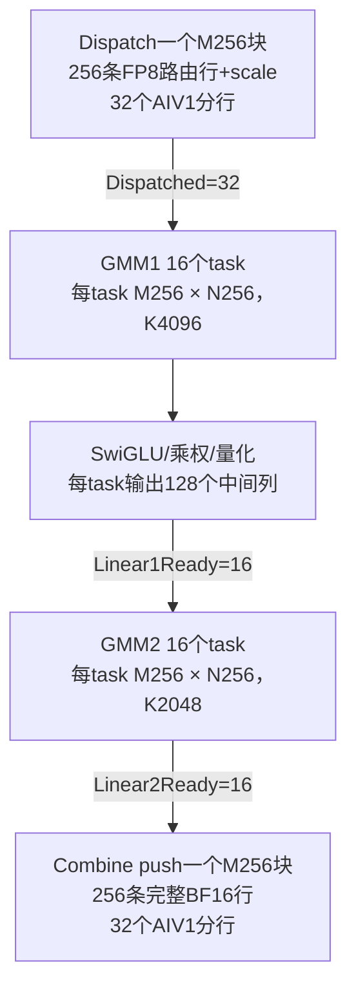

# MegaMoE：Dispatch、GEMM与Combine任务粒度

本文分析DeepGEMM-Ascend当前实现，沿用Flash的H4096/I2048，以一个满M256的routed块为例。源码依据：[主流水](../deep_gemm/include/deep_gemm/mega_moe.hpp)、[调度器](../deep_gemm/include/deep_gemm/scheduler/mega_moe.hpp)、[布局](../deep_gemm/include/deep_gemm/layout/mega_moe.hpp)。以下大小不是总rank数或EP组大小。

## 1. 六种单位

| 单位 | 当前含义 |
| --- | --- |
| 路由行 | 一个(token,top-k slot)对应一条expert输入/输出；不是去重后的原token |
| 单次DMA | 搬一行完整向量；输入token和scale分别执行DMA |
| advance调用 | 一个AIV1的小步推进，通常最多处理两条通信行 |
| M-block | 一个expert的逻辑行块，固定256行GM容量，valid_m可以小于256 |
| GEMM task | 一个M-block和一个N列块，内部计算完整K维 |
| 调度wave | 最多32个GEMM task，task_base每次增加32；无wave末尾全核barrier |

若将用户所说的wave定义为一批256行通信数据，则它对应一个满M-block。Dispatch代码没有独立的同步64行/256行发送轮次；32个AIV1各自推进。一个M-block的行也不保证是原始token连续行，源ordinal按专家计数和互质stride置换。

## 2. Dispatch的数据与推进大小

metadata预处理另外发送每路由8B的索引/FP32 top-k权重，并发布source/expert count；它不搬H维激活。实际数据Dispatch由AIV1从source rank拉取输入，经本核UB写本rank的l1_acts环。

```text
source GM的FP8 token/scale
        -> MTE2 -> UB pull槽
        -> MTE3 -> 本rank GM l1_acts/scale
```

H4096时，每条路由的输入为4096B FP8，加64个int16 scale pair即128B，共4224B，不计metadata和协议开销。token与scale分别搬运，不能将4224B理解成一个连续DMA包。

| Dispatch单位 | 满块示例的大小 |
| --- | --- |
| 一条路由行 | 4096B FP8 + 128B scale |
| 一个AIV1一次advance | 最多2行，即最多8448B源数据；另写本地GM |
| 一个AIV1负责一个M256块 | 8行，即33792B源数据 |
| 全部AIV1完成一个M256块 | 256行，共1056KiB源数据 |

行分工 `m=core_idx+32*k`。例如core5的一个满块：

```text
第1次有效advance：行5、37
第2次有效advance：行69、101
第3次有效advance：行133、165
第4次有效advance：行197、229
下一次推进：wait kPullDone，发布本核Dispatched贡献
```

“32核各推进两行”可覆盖64行，但不是一次整体通信调用，也没有每64行的跨核屏障。pull有两份UB行槽，stage=(m/32)%2，MTE3读完后用kPullEmpty允许下一次MTE2覆盖。每个owner完成整块自己的行、确认写出后贡献一次Dispatched；全部32个owner到齐，该M-block才允许GMM1读取。

即使当前块不足32行，没有有效行的owner也贡献完成证书。两行是当前函数的小步调度上限，pull循环复用kNumPullStages=2作为上限，目的在epilogue/push/pull间留出推进机会，不由expert接收总行数推导。

## 3. M-block如何确定

`BLOCK_M=256`是当前kernel的编译常量，决定GM槽步长和逻辑任务边界。每个expert独立需要ceil(received_rows/256)个块。expert不能为了填尾块而混入另一expert的行。

代码先把expert行数按16行组划分，再在这些块之间均分。例如257行分成144、113；不是先收到256行就固定成第一块、最后1行再开第二块。本轮metadata完整后，分块已经确定；valid_m不会因暂时只搬到某些行而动态改变。

256不是由当前T、top-k或权重维度自动算出来的最优值。它是实现选择，受矩阵/内存布局、L0C和UB/L1预算等约束；其他shape主要改变任务数与实际MAD配置。

## 4. GMM1和GMM2的一次task

对当前块有效M=m：

| 内容 | GMM1 task | GMM2 task |
| --- | --- | --- |
| 输入 | `[m,H]` | `[m,I]` |
| 权重逻辑块，按[N,K] | `[256,H]`，gate128/up128配对 | `[256,I]` |
| 输出 | `[m,256]` BF16，后处理成`[m,128]` FP8 | `[m,256]` BF16 |
| 完整K维 | H=4096 | I=2048 |
| 每M-block的task数 | I/128=16 | H/256=16 |

M256时每个task的BF16输出都是128KiB。GMM1的packed FP4 weight data为512KiB/task，GMM2为256KiB/task，未计scale。这些权重按K段分批进入缓冲，不是一口气全部驻留L1。AIC按顺序提交当前task的完整K计算与FIX，再推进下一task；数据实际完成仍由PIPE/CV事件确认。单条MAD不等于一个完整task。

GMM1全部16个列任务覆盖gate/up各2048列；SwiGLU后为2048个中间通道。GMM2全部16个列任务覆盖4096个最终通道。token数决定M块数，权重输出宽度决定N块数，输入宽度决定每个task的K-loop次数。

## 5. task内部的MAD与epilogue

| 当前配置 | L1的BLOCK_K | MAD_N | MAD_K | L0A/B每槽 |
| --- | --- | --- | --- | --- |
| valid_m<=128，M128配置 | 512 | 128 | 256 | 32KiB |
| valid_m>128，M256配置 | 256 | 256 | 128 | 32KiB |

实际MAD的M为Align16(valid_m)。L1 A/B tile各64KiB、L0A/B双缓冲各槽32KiB，MMAConfig由这些容量计算BLOCK_K、MAD_K和MAD_N。

满M256时，GMM1一个task的K4096分16个L1 K256段，每段两次K128 MAD，共32次MAD；GMM2的K2048分8段，共16次MAD。M128配置每K256 MAD需再拆两次N128，同shape的调用数仍为32/16，但计算M/N/K不同。

GMM1 FIX输出分两份M128*N256 UB槽，每份64KiB BF16；AIV1每次epilogue最多算32行，完整有效M128 stage处理完再写GM，并释放该UB槽。一个task全部有效行结束后贡献一次Linear1Ready。整块全部16个GMM1列任务完成，GMM2才能读取中间激活；32行epilogue完成不是GMM2单独放行条件。

## 6. task到调度wave的对应

Flash中G1/G2的N块数均为16：

```text
第j个调度wave：task=[32*j,32*j+32)
core0~15：M-block 2*j，N-block 0~15
core16~31：M-block 2*j+1，N-block 0~15
```

一个通信wave（按用户定义的满M256块）生成16个G1、16个G2任务。每层一个满调度wave则包含两个通信块的32个任务。

这些task不要求同时ready才启动。每个AIC等自己的块。只剩一块时另外16核跳过无效task，不等待下一次launch补满；但固定lookahead可能让本核先等后续块的G1，再做前一块G2，详见[Flash分析](deepseek_v4_flash_core_partition_zh.md)。

## 7. Combine push的五个大小

Combine不是按GMM2的256列分片回传，而是等待整个H维行完整后回传。因此当前block的全部16个GMM2列任务贡献Linear2Ready后，32个AIV1才开始读取该块的完整BF16行。

```text
本rank GM输出环的一行BF16[H]
        -> MTE2 -> UB push槽
        -> MTE3 -> source rank的[token,top-k slot]接收槽
```

| Combine单位 | Flash满块示例 |
| --- | --- |
| 单行数据/DMA | H*2=8192B，即8KiB |
| 一个AIV1一次advance | 最多2行，即16KiB；循环上限固定为2 |
| 一个AIV1负责一个M-block | 8行，即64KiB |
| push UB缓冲 | 每核4个行槽，共32KiB |
| 一个M-block全部回传 | 256行，即2MiB |
| 常规完成确认批次 | 4个逻辑M-block，满块时全rank共8MiB；每核32行 |

push同样按 `m=core_idx+32*k` 分行，但stage=(m/32)%4。四个槽不断用kPushEmpty/kPushFull保护并复用，不保存整批32行；每次最多两行的小步推进上限与四槽数量独立。

每个AIV1按pool_block_idx从0顺序回传，一个块结束后推进下一块。当前块未Linear2Ready时返回主循环，不跳到后面已ready的块；主循环可尝试epilogue或Dispatch。该顺序与GEMM的M/N task调度不同。

通常每4个块用MTE3->S排空等待统一确认，再分别发布这些块的CombineSent贡献。4来自32行预算*32核/256行，不是四槽大小推导出的必要条件；小块实际行数可能少于32。非overlap最后块强制发布；overlap最后一个非空expert逐块发布，以及时形成归并前缀。

最终Combine reduce在source rank求和各top-k槽与shared槽，任务是一个原token的通道chunk。chunk宽度由当前阶段UB剩余空间、两份reduce槽和最多7份输入决定，每次推进的chunk步数另设预算。它与push的两行推进、四块确认不是同一种粒度。

## 8. 一个满块的数据量与放行关系



数据搬运及ready单位为M-block，计算分配单位为M/N tile，主循环公平推进单位为小步。源码中的2、4、16、32、128、256分别承担这些不同作用，不能把它们统一解释成一个wave大小。
